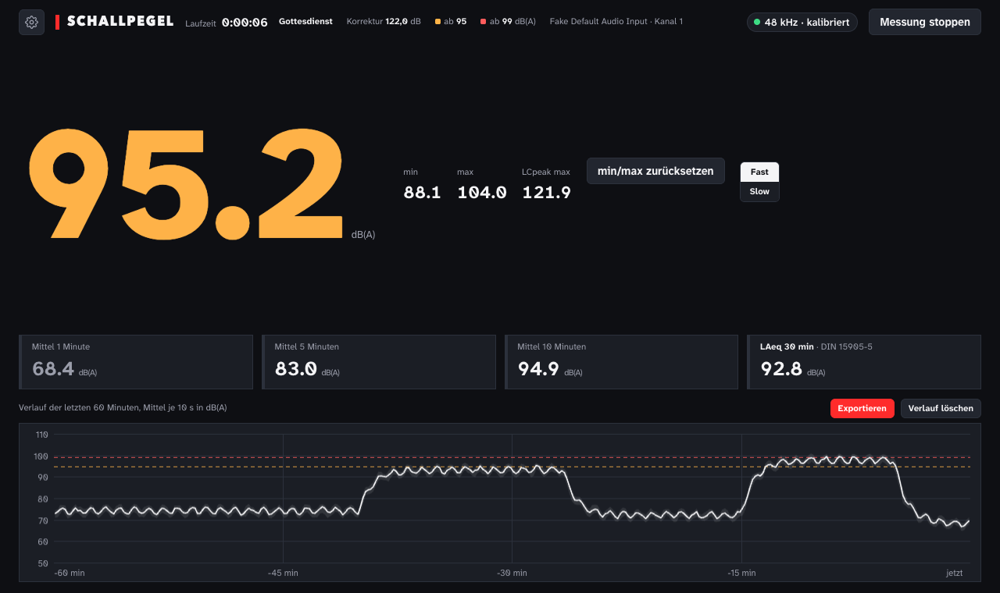

# Schallpegel-Messer im Browser

[English](README.md) · **Deutsch**

Ein Schallpegel-Messer für jeden aktuellen Browser: große dB(A)-Anzeige, **LAeq 30 min** und **LCpeak** nach DIN 15905-5, Verlauf und ein **Protokoll als PDF** für den Veranstalter. Gebaut für Gottesdienste und Veranstaltungen, jeden Sonntag live im Einsatz.

**👉 Öffnen: [spl.flotech.dev](https://spl.flotech.dev)** · mit ausgedachten Daten ausprobieren: [spl.flotech.dev/?demo](https://spl.flotech.dev/?demo)

> [!WARNING]
> **Kein geeichtes Messgerät.** Die Genauigkeit hängt von Mikrofon, Interface und Kalibrierung ab. Gut zur Orientierung und Dokumentation, nicht dort, wo ein Messgerät der Klasse 1/2 (DIN EN 61672) vorgeschrieben ist.



[](https://ko-fi.com/floslist)

## Was es kann
- **Pegel** in dB(A), Fast oder Slow, min, max und **LCpeak** (C-bewertete Spitze)
- **Mittelwerte** über 1, 5, 10 und **30 Minuten** (gleitender LAeq, danach bewertet die DIN 15905-5), gefärbt nach deinen Grenzwerten
- **Verlauf** der letzten 60 Minuten, 20 Stunden bleiben auf dem Gerät gespeichert, auch nach dem Neuladen
- **Exportieren** für jeden Zeitraum (letzte Stunde, ganze Messung, jeder Gottesdienst): Bild, **Protokoll als PDF** mit Grenzwerten und Bewertung oder **CSV** mit einer Zeile pro Minute
- **Kalibrierung** mit Kalibrator auf 94 oder 110 dB, oder bekannten Korrekturwert eintippen
- **Gottesdienstzeiten:** nach einer Stunde erscheint ein Knopf für den jeweiligen Gottesdienst
- **Als App installierbar** (PWA), läuft offline, der Bildschirm bleibt beim Messen an
- **Deutsch und Englisch**
- **Privat:** alles bleibt im Browser, nichts wird hochgeladen

## Loslegen
1. [spl.flotech.dev](https://spl.flotech.dev) öffnen, Mikrofon erlauben
2. Eingang wählen. Für echte Messungen ein Messmikrofon am Audio-Interface nehmen, nicht das eingebaute Mikrofon
3. Kalibrieren, danach den Gain nicht mehr anfassen
4. Optional installieren (iPhone: Teilen → *Zum Home-Bildschirm*, Chrome/Edge: Installieren-Symbol in der Adresszeile)

Die Einstellungen bleiben auf dem Gerät und stehen in der Adresszeile, ein Lesezeichen nimmt Korrekturwert und Grenzwerte also mit. Ist das Mikrofon erlaubt und ein Korrekturwert gesetzt, startet die Messung sofort.

## Protokoll


## Wie gemessen wird
- Web Audio API, Echounterdrückung, Rauschunterdrückung und automatische Verstärkung **aus**
- A- und C-Bewertung als IIR-Filter nach IEC 61672 (bilineare Transformation, bei 1 kHz auf 0 dB normiert)
- Energie wird in einem AudioWorklet alle 50 ms gemittelt, Fast = 125 ms, Slow = 1 s
- LCpeak ist der höchste Abtastwert des C-bewerteten Signals, kein überabgetasteter True Peak
- Übersteuerung am Eingang wird erkannt und im Protokoll vermerkt

## Selbst betreiben
Reines HTML, CSS und JavaScript, kein Build. Das Mikrofon gibt der Browser nur über https oder auf localhost frei:

```sh
python3 -m http.server 8000   # dann http://localhost:8000 öffnen
```

## Grenzwerte
Voreinstellung nach DIN 15905-5: Warnhinweis ab 95 dB(A), Obergrenze 99 dB(A) (beides LAeq 30 min), 135 dB(C) LCpeak. Schweiz: 93 und 96 dB(A). Andere Länder: selbst eintragen.

## Verwandte Projekte
- [allenheath-talkback](https://github.com/Floslis/allenheath-talkback) · Talkback-Schaltung für Allen & Heath Pulte

## Lizenz
[MIT](LICENSE) · Schrift [Atkinson Hyperlegible Next](https://www.brailleinstitute.org/freefont/) unter der SIL Open Font License · Ein Projekt von **[FLOTECH](https://flotech.dev)**
