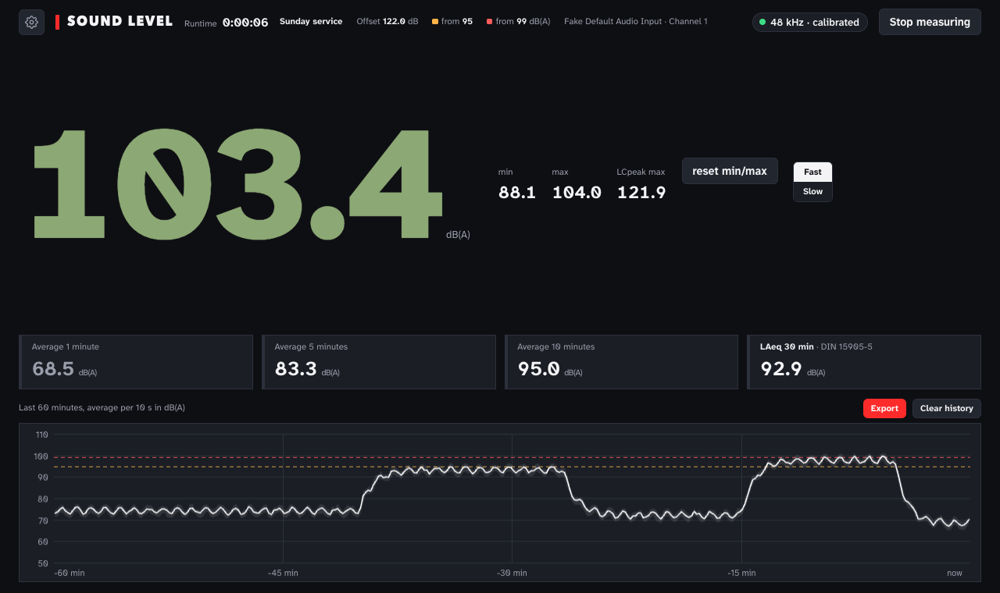
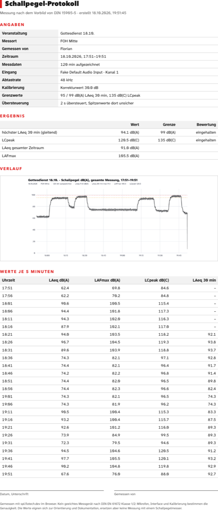

# SPL meter · sound level in the browser

**English** · [Deutsch](README.de.md)

A sound level meter that runs in any modern browser: big dB(A) reading, **LAeq 30 min** and **LCpeak** following the German event standard DIN 15905-5, a history graph and a **PDF report** for the organiser. Built for church services and events, used live every Sunday.

**👉 Open it: [spl.flotech.dev](https://spl.flotech.dev)** · try it with fake data: [spl.flotech.dev/?demo](https://spl.flotech.dev/?demo)

> [!WARNING]
> **Not a certified sound level meter.** Accuracy depends on your microphone, interface and calibration. Use it for guidance and documentation, not where the law requires a class 1/2 meter (IEC 61672).



[](https://ko-fi.com/floslist)

## What it does
- **Level** in dB(A), Fast or Slow, min, max and **LCpeak** (C-weighted peak)
- **Averages** over 1, 5, 10 and **30 minutes** (moving LAeq, the value DIN 15905-5 judges by), coloured by your limits
- **History** of the last 60 minutes on screen, 20 hours kept on the device, survives a reload
- **Export** any period (last hour, whole measurement, each service): image, **report as PDF** with limits and verdict, or **CSV** with one row per minute
- **Calibration** with a 94 or 110 dB calibrator, or type a known offset
- **Service times**: after an hour a button for that service shows up
- **Installable app** (PWA), works offline, screen stays on while measuring
- **English and German**
- **Private:** everything stays in the browser, nothing is uploaded

## Getting started
1. Open [spl.flotech.dev](https://spl.flotech.dev), allow the microphone
2. Pick the input. For real measurements use a measurement mic on an audio interface, not the built-in mic
3. Calibrate, then don't touch the gain any more
4. Optional: install it (iPhone: Share → *Add to Home Screen*, Chrome/Edge: install icon in the address bar)

Settings are stored on the device and in the address bar, so a bookmark carries offset and limits. With the microphone allowed and an offset set, measuring starts right away.

## Report


## How it measures
- Web Audio API, echo cancellation, noise suppression and auto gain switched **off**
- A and C weighting as IIR filters after IEC 61672 (bilinear transform, normalised to 0 dB at 1 kHz)
- Energy averaged in an AudioWorklet every 50 ms, Fast = 125 ms, Slow = 1 s
- LCpeak is the highest sample of the C-weighted signal, not oversampled true peak
- Clipping of the raw input is detected and noted in the report

## Run it yourself
Plain HTML, CSS and JavaScript, no build step. The browser only allows the microphone over https or on localhost:

```sh
python3 -m http.server 8000   # then open http://localhost:8000
```

## Limits
DIN 15905-5 defaults: audience warning from 95 dB(A), maximum 99 dB(A) (both LAeq 30 min), 135 dB(C) LCpeak. Switzerland: 93 and 96 dB(A). Other countries: set your own.

## Related
- [allenheath-talkback](https://github.com/Floslis/allenheath-talkback) · talkback switching for Allen & Heath desks

## License
[AGPL-3.0](LICENSE): free to use, change and share. Anyone who distributes it or offers it as a web service must publish their source code under the same license. © 2026 Florian Hogrebe. Versions up to 1.0.1 were released under MIT. · font [Atkinson Hyperlegible Next](https://www.brailleinstitute.org/freefont/) under the SIL Open Font License · A project by **[FLOTECH](https://flotech.dev)**
